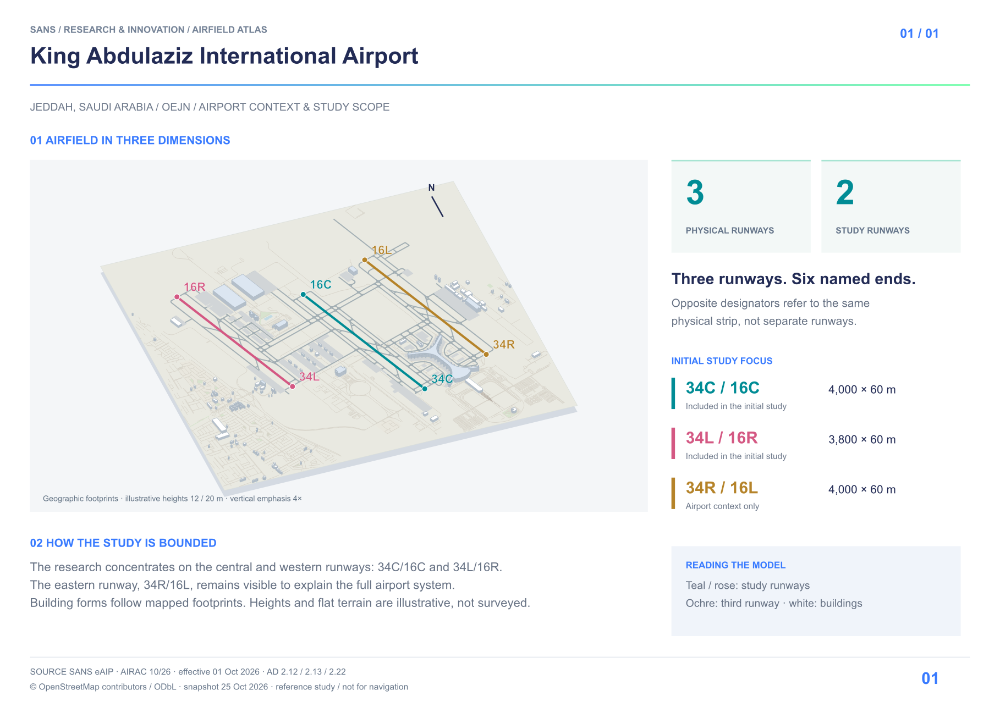

# OEJN departure mapping

How do departure routes at King Abdulaziz International Airport (OEJN) affect fuel use, CO₂ and community noise?

This repo is the mapping groundwork for that question: the airport on the ground, the published departure procedures, and clean datasets to match real flights against. It was built for the Research and Innovation department at SANS.

**Live demo:** [Map 1, ground atlas](https://m-alghazali.github.io/Research-and-Innovation-department-SANS-project/map-1/Open-ground-map.html) · [Map 2, 3D departure explorer](https://m-alghazali.github.io/Research-and-Innovation-department-SANS-project/map-2/)

## What I built

- **QGIS ground atlas.** Runways, taxiways, aprons, terminals and the neighbourhoods around the airport, styled from OpenStreetMap and the SANS AIP. The [QGIS project](map-1/OEJN-ground-atlas.qgz) and [GeoPackage](map-1/OEJN-ground.gpkg) are in `map-1/` if you want to open or edit them.
- **Browser maps.** Map 1 is the atlas as a single HTML page. Map 2 is a three.js scene of the published departure fixes with illustrative flight playback. Both are static files, with no backend.
- **Published-procedure datasets.** [`A1_Procedures.csv`](data/A1_Procedures.csv) has the 16 published departure procedures (SIDs) from runways 34C and 34L, one row per leg: 105 legs over 36 waypoints. [`External_Airport_Runways.csv`](data/External_Airport_Runways.csv) is a lookup for all six runway ends. Fields and conventions are in [data/README.md](data/README.md).
- **Source provenance.** The original AIP tables and the OpenStreetMap snapshot are kept unchanged in `sources/`. Each CSV row records the source file, page and hash it came from, so any value can be checked against the original.
- **CI and GitHub Pages.** A workflow publishes both maps to GitHub Pages on every push to `main`. A second one runs the Python and JS tests and fails if the generated reference data changes unexpectedly.

`tools/` rebuilds the maps (run it from the repo root), `dataset_tools/` rebuilds the dataset, and `Start Map 2.cmd` runs Map 2 locally.

## Team and related work

- **Khalid Al Amoudi** ([@iKhalidf](https://github.com/iKhalidf)) built the A2 observed-flights pipeline in this repo. It rebuilds departures from recorded tracks and ranks which published procedure each one fits.
- **Hala Al-Ali** ([@Hala-Alali](https://github.com/Hala-Alali)) built the A3/A4 weather and fuel stage (`sans_a2 fuel`). It joins ERA5 weather with the A2 departures and estimates fuel burn to 10,000 ft with OpenAP. The original analysis is in [Hala-Alali/OEJN_Aircraft_Fuel_Weather](https://github.com/Hala-Alali/OEJN_Aircraft_Fuel_Weather).
- [M40aha/oejn-noise-population](https://github.com/M40aha/oejn-noise-population) models noise from observed jet departures with ECAC Doc 29 and counts the residents exposed.

## Status and limitations

This initiative maps King Abdulaziz International Airport ground features and published departure procedures, as the visual groundwork for a proposal to SANS. The longer-term aim is to assess operational efficiency, fuel consumption, CO₂ emissions, and community noise using observed flights and suitable models. These maps are a visual prototype for that proposal; they do not measure those outcomes.

The datasets cover the initial 34C/34L scope. Map 2 additionally shows 34R for context.

The local A2 pipeline reconstructs departure candidates and ranks geometric procedure matches. The viewer supports multiple recorded flights on a UTC timeline while retaining illustrative procedure mode. See [A2 setup](docs/A2_SETUP.md), [methods and limits](docs/A2_METHODS.md), and [validation/readiness](docs/A2_READINESS.md). Real traffic exports stay outside this repository and are excluded from the static deployment.

Reference study only, not for navigation.

## Data sources

- **SANS AIP, AIRAC AMDT 10/26, effective 1 October 2026.** OEJN aerodrome data and the RNAV SID tables for runways 34C, 34L and 34R. Copies are in `sources/`.
- **OpenStreetMap**, snapshot of 25 October 2026, pulled with the Overpass query in [`sources/overpass-query.txt`](sources/overpass-query.txt). © OpenStreetMap contributors, ODbL.
- **three.js** for Map 2, vendored in `map-2/vendor/` under its own licence.

## How to cite

If you use the maps or the datasets, please cite this repo. The "Cite this repository" button on GitHub reads [CITATION.cff](CITATION.cff), or use:

> Alghazali, M. (2026). *OEJN departure mapping: ground atlas, departure explorer and published-procedure datasets* [Software and data]. GitHub. https://github.com/M-AlGhazali/Research-and-Innovation-department-SANS-project

## Licence

Code is [MIT](LICENSE). My CSV datasets are CC BY 4.0. OpenStreetMap-derived data stays ODbL, and the SANS AIP material in `sources/` isn't covered. Details are in [DATA_LICENSE.md](DATA_LICENSE.md).
